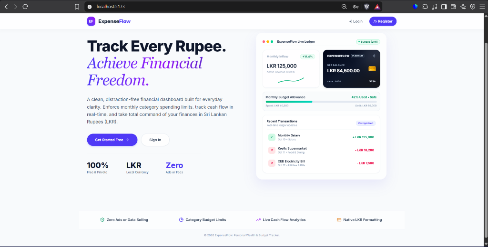
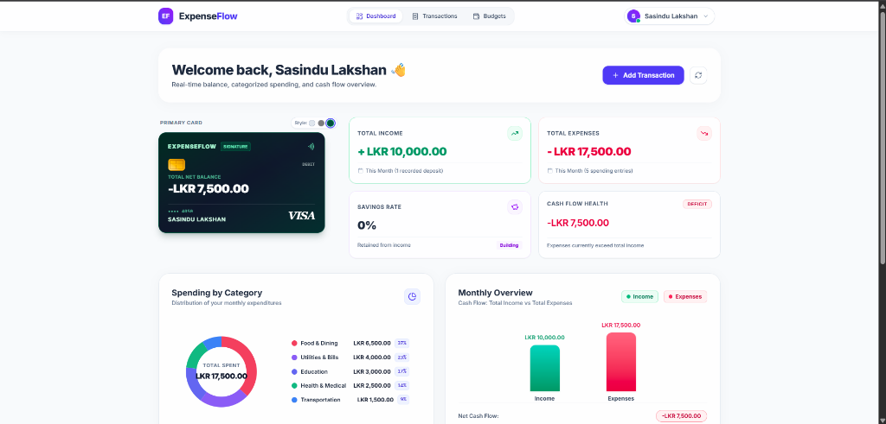
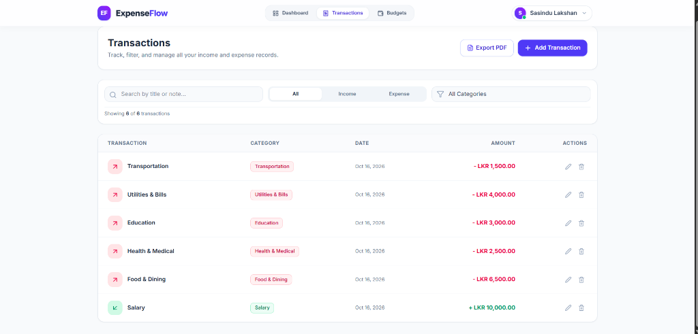
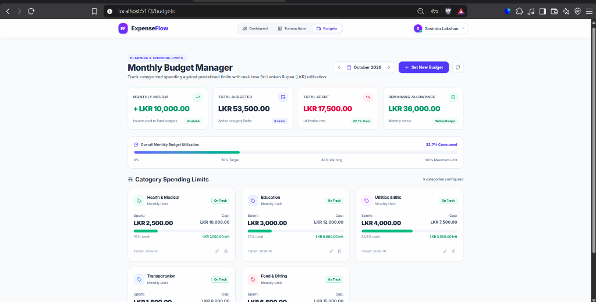

# 💰 ExpenseFlow – Personal Expense & Budget Tracker

ExpenseFlow is a modern, intuitive full-stack financial management web application built with the MERN stack (MongoDB, Express, React, Node.js). It empowers users to monitor their daily expenses, track income streams, categorize financial transactions, enforce monthly category budgets, and maintain complete visibility over their personal finances with native Sri Lankan Rupee (`LKR`) formatting.


---

## 📸 Application Screenshots

### 1. Modern Landing Page
A clean, distraction-free hero showcase with interactive application mockups and clear trust metrics.


### 2. Financial Dashboard 
Real-time net balance widget featuring a metallic VISA Debit card, cashflow overview cards, and interactive spending distribution chart.


### 3. Transaction Ledger & PDF Statement Export
Comprehensive transaction ledger with real-time keyword search, income/expense filtering, and branded PDF statement export.


### 4. Monthly Category Budget Planning & Analytics
Month-by-month budget manager (`YYYY-MM`) with 4 KPI financial health cards and dynamic utilization alert bars (Safe, Warning, Exceeded).


---

## ✨ Features

* **Secure Authentication:** User registration and login powered by bcrypt password hashing and JSON Web Tokens (JWT) with protected route authorization.
* **Income & Expense Management:** Seamlessly record, view, edit, and delete financial records with category-driven workflows.
* **Smart Categorization:** Automatically categorize transactions into standardized spending categories (Food & Dining, Utilities, Transportation, Salary, Education, etc.).
* **Real-Time Search & Filtering:** Filter transactions instantly by cashflow type (Income vs Expense), category, or live keyword search without page reloads.
* **Branded PDF Financial Statement:** Generate and download official A4 PDF account statements with KPI summary cards and structured ledger tables via jsPDF.
* **Monthly Budget Planning Engine:** Set spending limits per category, track real-time utilization progress, and receive color-coded health alerts.
* **Luxury Metallic Card Hub:** Interactive debit card widget with Obsidian, Platinum, and Emerald skins displaying real-time net balance.
* **Sri Lankan Rupee (LKR) Standardization:** Universal `LKR X,XXX.XX` currency formatting across all views.
* **Mobile-First Responsive Design:** Fully responsive layout with mobile slide-out navigation menu for phones, tablets, and desktops.

---

## 🛠️ Technology Stack

### Frontend
* **Library / Framework:** React 19, Vite
* **Styling:** Tailwind CSS, PostCSS
* **Icons:** Lucide React
* **Routing:** React Router DOM (v7)
* **HTTP Client:** Axios (with automated JWT Bearer interceptor)
* **Document Generation:** jsPDF, jspdf-autotable

### Backend
* **Runtime:** Node.js
* **Framework:** Express.js
* **Database:** MongoDB Atlas (Cloud) / Local MongoDB
* **ODM:** Mongoose
* **Authentication & Security:** JSON Web Token (JWT), bcryptjs, CORS

---

## 📁 Project Architecture

```text
ExpenseFlow/
├── client/                 # React Frontend (Vite + Tailwind CSS)
│   ├── public/             # Static Assets & Icons
│   ├── src/
│   │   ├── components/     # Reusable UI (Navbar, Modals, ProtectedRoute)
│   │   ├── context/        # State Management (AuthContext)
│   │   ├── pages/          # Views (Landing, Login, Register, Transactions, Dashboard, Budgets)
│   │   ├── services/       # API Services (api client, transactionService, budgetService)
│   │   ├── utils/          # Helpers & formatters (LKR currency, dates, pdfExport)
│   │   ├── App.jsx         # App Root & Client-side Routing
│   │   └── main.jsx        # App Mount Point
│   └── package.json
├── server/                 # Express Backend API
│   ├── config/             # Database connection (db.js)
│   ├── controllers/        # Request Handlers (authController, transactionController, budgetController)
│   ├── middleware/         # Security & JWT verification (authMiddleware)
│   ├── models/             # Mongoose Schemas (User, Transaction, Budget)
│   ├── routes/             # API Route Definitions (authRoutes, transactionRoutes, budgetRoutes)
│   ├── server.js           # Express Server Entrypoint
│   └── package.json
├── docs/
│   └── screenshots/        # Main Feature Showcase Screenshots
├── vercel.json             # Vercel Multi-Service Deployment Configuration
└── README.md               # Project Documentation
```

---

## 🚀 Getting Started & Setup Instructions

### Prerequisites
* [Node.js](https://nodejs.org/) (v18.x or later)
* [MongoDB](https://www.mongodb.com/) running locally or a MongoDB Atlas connection URI

### 1. Backend Setup
1. Open a terminal and navigate to the `server` directory:
   ```bash
   cd server
   ```
2. Install dependencies:
   ```bash
   npm install
   ```
3. Create a `.env` file in the `server` folder:
   ```env
   PORT=5000
   MONGO_URI=your_mongodb_connection_uri
   JWT_SECRET=your_jwt_secret_key
   ```
4. Start the Express backend server:
   ```bash
   npm run dev
   ```
   *The backend API runs on `http://localhost:5000`.*

### 2. Frontend Setup
1. In a new terminal, navigate to the `client` directory:
   ```bash
   cd client
   ```
2. Install dependencies:
   ```bash
   npm install
   ```
3. Start the Vite development server:
   ```bash
   npm run dev
   ```
   *The frontend client runs on `http://localhost:5173`.*

---

## 🔒 API Endpoints

### Authentication
* `POST /api/auth/register` - Register a new user account
* `POST /api/auth/login` - Authenticate user & issue JWT token
* `GET /api/auth/me` - Fetch currently authenticated user profile (Protected)

### Transactions
* `GET /api/transactions` - Retrieve user transactions with optional type/category filters (Protected)
* `POST /api/transactions` - Create a new income or expense record (Protected)
* `PUT /api/transactions/:id` - Update an existing transaction (Protected)
* `DELETE /api/transactions/:id` - Remove a transaction (Protected)

### Monthly Budgets
* `GET /api/budgets?month=YYYY-MM` - Fetch all category budgets and live spent utilization for a month (Protected)
* `POST /api/budgets` - Create or update a category budget limit (Protected)
* `DELETE /api/budgets/:id` - Delete a category budget allocation (Protected)

---
