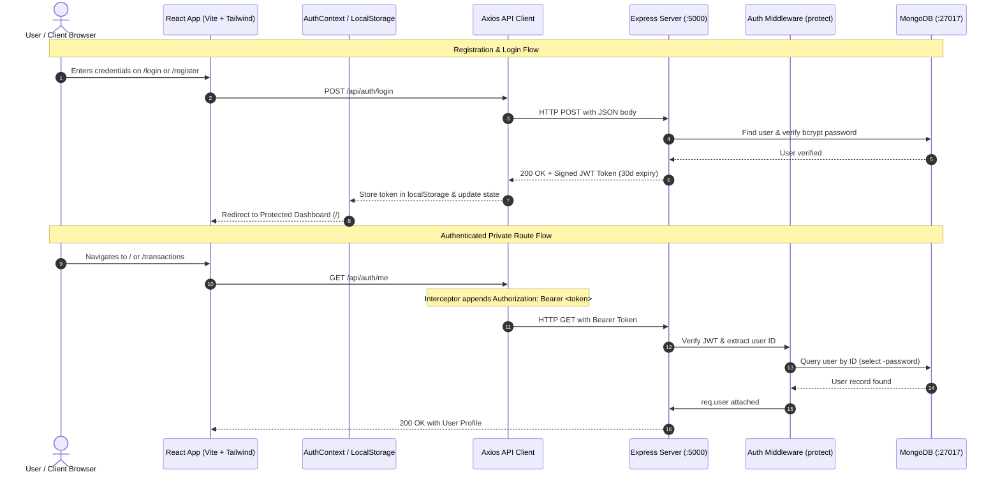

# 📄 ExpenseFlow – Internship Engineering Progress Report
**Software Engineering Team 405 – Individual Assignment**  
**Reporting Period:** Day 1 – Day 2 (October 09 – October 10, 2026)  
**Submission Deadline:** October 16, 2026, at 3:00 PM (Sri Lanka Time)  

---

## 1. Executive Summary & Project Metadata

| Field | Detail |
| :--- | :--- |
| **Project Title** | ExpenseFlow – Personal Expense & Budget Tracker |
| **Assignee** | Software Engineering Intern |
| **Team / Module** | Software Engineering Team 405 |
| **Lead Developer / Mentor** | Senior Full-Stack Developer & Project Mentor |
| **Current Project Stage** | Day 2 Complete (Authentication & Security Architecture) |
| **Overall Schedule Health** | **ON TRACK (100% on schedule)** |
| **Repository Status** | Local Git initialized, structured commits, origin linked to GitHub |

---

## 2. Cumulative Development Progress Matrix

```
[Day 1: Oct 09]  Architecture Planning & Scaffolding  ████████████████  100% (PASS)
[Day 2: Oct 10]  User Auth, JWT, bcrypt & UI Guards    ████████████████  100% (PASS)
[Day 3: Oct 11]  Income & Expense CRUD APIs & Forms    ░░░░░░░░░░░░░░░░  Scheduled
[Day 4: Oct 12]  Dashboard Overview & Analytics        ░░░░░░░░░░░░░░░░  Scheduled
[Day 5: Oct 13]  Monthly Budgets & Chart Visualizer    ░░░░░░░░░░░░░░░░  Scheduled
[Day 6: Oct 14]  Responsive UI & Error Handling        ░░░░░░░░░░░░░░░░  Scheduled
[Day 7: Oct 15]  Testing, Documentation & Demo Video   ░░░░░░░░░░░░░░░░  Scheduled
[Day 8: Oct 16]  Final Verification & Submission       ░░░░░░░░░░░░░░░░  Scheduled
```

---

## 3. System Architecture & Authentication Flow



---

## 4. Detailed Day 2 Technical Achievements

### A. Cryptographic Security & Password Hashing
* **Library:** `bcryptjs`
* **Salt Factor:** 10 salt rounds (\(2^{10} = 1024\) hashing iterations) to mitigate brute-force and dictionary attacks.
* **Mongoose Lifecycle Integration:** Created an asynchronous `pre('save')` hook on the `User` schema that automatically hashes plain-text passwords prior to database persistence.
* **Instance Method:** Built `comparePassword(candidatePassword)` utilizing constant-time comparison to prevent timing attacks.

### B. RESTful Authentication API Endpoints
* **`POST /api/auth/register`**: Validates user inputs (name, email, password length \(\ge 6\)), performs duplicate collision checks in MongoDB, creates the user record, and issues a 30-day signed JSON Web Token (`201 Created`).
* **`POST /api/auth/login`**: Authenticates credentials via email lookup and bcrypt verification, returning a JWT bearer token upon success (`200 OK`) or an error response (`401 Unauthorized`) for invalid credentials.
* **`GET /api/auth/me`**: Protected route guarded by middleware, safely returning the authenticated user profile with sensitive password fields strictly excluded (`.select('-password')`).

### C. Backend Route Guard Middleware
* Developed `protect` middleware in `server/middleware/authMiddleware.js`.
* Checks for incoming HTTP `Authorization: Bearer <token>` headers.
* Decodes the payload with `jwt.verify()` using `process.env.JWT_SECRET`.
* Rejects malformed, missing, or expired tokens with standard `401 Unauthorized` responses.

### D. Frontend State Management & API Interceptors
* **Axios Request Interceptor:** Centralized in `client/src/services/api.js`, automatically attaching active JWT tokens to all outgoing network requests.
* **React Context API:** Implemented `AuthContext.jsx` providing global state (`user`, `token`, `loading`, `login`, `register`, `logout`) with synchronization to browser `localStorage` for cross-refresh session persistence.
* **Protected Route Wrapper:** Created `ProtectedRoute.jsx` guarding application routes (`/`, `/transactions`, `/budgets`). Unauthenticated sessions are automatically redirected to `/login`.
* **User Interface:** Developed responsive, Tailwind-styled login and registration views with client-side form validation, error state indicators, and dynamic navigation bar controls.

---

## 5. Quality Assurance & Test Verification Matrix

All software components were systematically tested using automated test runners and build verification scripts.

| Category | Target | Method / Endpoint | Expected Result | Actual Result | Status |
| :--- | :--- | :--- | :--- | :--- | :--- |
| **Cryptography** | `User.js` Model | `bcrypt.hash(pwd, 10)` | Generates 60-character hash | `$2b$10$hgEtx...` verified | ✅ **PASS** |
| **Validation** | `User.js` Method | `comparePassword()` | Accepts match, rejects mismatch | True on correct, False on wrong | ✅ **PASS** |
| **Auth API** | Registration | `POST /api/auth/register` | `201 Created` with Token | Status 201 + valid JWT payload | ✅ **PASS** |
| **Auth API** | Login (Valid) | `POST /api/auth/login` | `200 OK` with Token | Status 200 + valid JWT payload | ✅ **PASS** |
| **Auth API** | Login (Invalid) | `POST /api/auth/login` | `401 Unauthorized` | Status 401: Invalid credentials | ✅ **PASS** |
| **Security** | Private Route | `GET /api/auth/me` (No token) | `401 Unauthorized` | Status 401: No token provided | ✅ **PASS** |
| **Security** | Private Route | `GET /api/auth/me` (Fake token) | `401 Unauthorized` | Status 401: Token invalid | ✅ **PASS** |
| **Security** | Private Route | `GET /api/auth/me` (Valid token)| `200 OK` | Status 200: Profile returned | ✅ **PASS** |
| **Data Protection**| Private Route | Password exclusion check | Password is omitted | `password === undefined` confirmed | ✅ **PASS** |
| **Frontend** | Build System | `vite build` | Clean production bundle | Built in 2.90s, 0 errors | ✅ **PASS** |
| **Routing** | Route Guard | Unauthenticated access | Redirect to `/login` | Verified via ProtectedRoute | ✅ **PASS** |

---

## 6. Git Version Control & Commit Traceability

A disciplined Git commit history has been maintained with descriptive, conventional commit messages:

```text
15723fa (HEAD -> main) docs: update daily progress log for Day 2 completion
9f40737 feat(auth): implement frontend AuthContext, Axios interceptor, Login/Register UI & ProtectedRoute
d1d46f9 feat(auth): implement backend registration, login, bcryptjs hashing & JWT protect middleware
20a4be9 feat(server): setup Express backend server, Mongoose models & MongoDB connection
bfcc825 feat(client): setup React, Vite, Tailwind CSS v4 & React Router
f643f40 chore: initial project planning and documentation (Day 1)
```

---

## 7. Learning Outcomes & Professional Development

1. **Applied Cryptography:** Real-world application of salting and hashing algorithms in web applications.
2. **Stateless Authentication Architecture:** Managing JSON Web Tokens, cryptographic signing, expiration windows, and token verification.
3. **Middleware Engineering:** Designing decoupled request processing pipelines using Express middlewares.
4. **React Enterprise Architecture:** Centralizing application-level state with the Context API, avoiding prop drilling, and synchronizing state with browser storage APIs.
5. **Defensive Coding:** Implementing input sanitization, error boundaries, and preventing sensitive data leakage.

---

## 8. Next Milestones: Day 3 (October 11, 2026)

* **Backend:** Implement RESTful CRUD API endpoints for transactions (`GET`, `POST`, `PUT`, `DELETE` on `/api/transactions`).
* **Data Association:** Link all financial transactions to the authenticated user ID (`req.user._id`).
* **Frontend:** Build intuitive transaction creation forms with income/expense toggles, category selectors, date pickers, and amount inputs.
* **Testing:** Automated API testing for transaction CRUD operations.

---
*Report certified by Senior Full-Stack Developer & Mentorship Team.*
